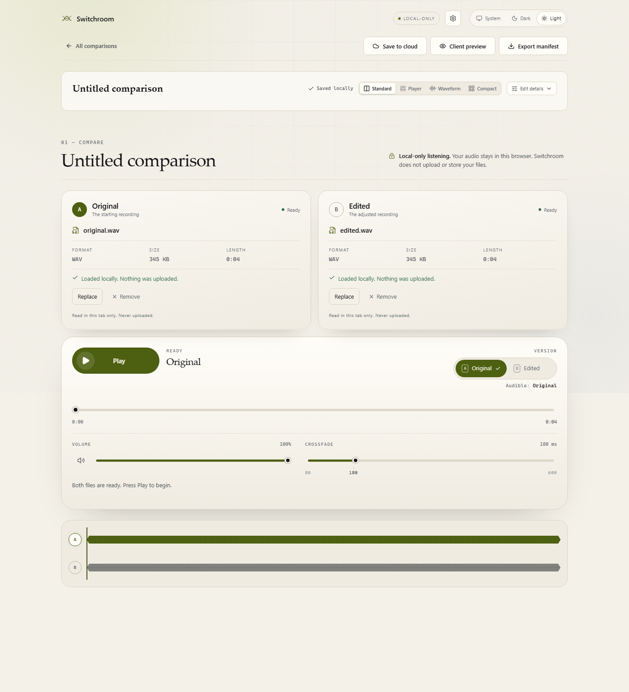
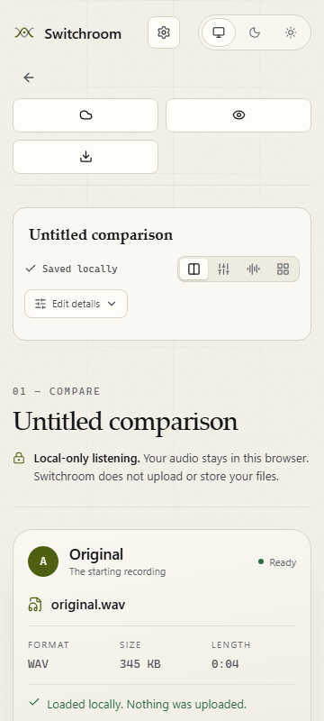
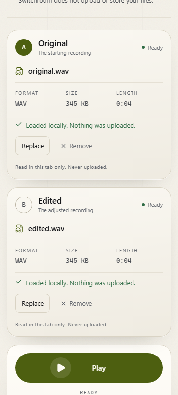
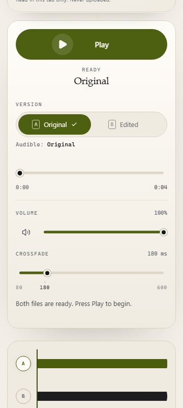
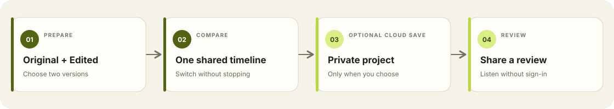

# Switchroom

<p align="center">
  <strong>Hear the difference.</strong><br>
  Compare two versions of a recording on one synchronized timeline, then switch between them with a real Web Audio crossfade.
</p>

<p align="center">
  <a href="https://switchroom.ftallfettah.workers.dev">Open the live app</a> ·
  <a href="https://github.com/Fettah010/switchroom/releases/tag/v0.6.0">v0.6.0 release</a>
</p>

<p align="center">
  <a href="https://github.com/Fettah010/switchroom/actions/workflows/ci.yml"></a>
  <a href="https://github.com/Fettah010/switchroom/releases/latest"></a>
  <a href="LICENSE"></a>
</p>

## Preview

<table align="center" width="100%">
  <tr>
    <td width="50%"></td>
    <td width="50%"></td>
  </tr>
  <tr>
    <td align="center"><sub>Light</sub></td>
    <td align="center"><sub>Dark</sub></td>
  </tr>
</table>

<p align="center"><strong>Phone · 360 px</strong></p>

<table align="center" width="100%">
  <tr>
    <td align="center" width="33.3%"><br><sub>01 · Workspace</sub></td>
    <td align="center" width="33.3%"><br><sub>02 · Files</sub></td>
    <td align="center" width="33.3%"><br><sub>03 · Player</sub></td>
  </tr>
</table>

<p align="center"><sub><a href="docs/screenshots/mobile-360.png">View the full-size phone capture</a></sub></p>

## At a glance

<table align="center" width="100%">
  <tr>
    <th align="center" width="25%">🎚️ Local compare</th>
    <th align="center" width="25%">☁️ Cloud save</th>
    <th align="center" width="25%">🔗 Guest review</th>
    <th align="center" width="25%">🔒 Password links</th>
  </tr>
  <tr>
    <td align="center">✅ Ready</td>
    <td align="center">✅ Ready</td>
    <td align="center">✅ Ready</td>
    <td align="center">⏸️ Off in v0.6</td>
  </tr>
</table>

<p align="center"><strong>From local comparison to client review</strong></p>

<p align="center"></p>

## What it does

- **Compare locally:** load WAV, MP3, FLAC, AAC or M4A files. One playhead keeps both versions aligned; switch mid-play with an adjustable 80–600 ms crossfade.
- **Save when you choose:** upload a comparison to a private Cloudflare R2 project. Local playback never uploads files automatically.
- **Share a review:** create public, unlisted or private invite links with expiry and revocation. Clients can play, seek and switch versions without signing in.
- **Use it your way:** optional GitHub or Google sign-in for creators; guest creators can manage projects through a private recovery link.

## Privacy and limits

- Local audio is read in the browser and never sent to a server. Workspace metadata may be saved locally; audio bytes are not.
- Cloud audio is stored under opaque object keys. Playback uses short-lived, authorized URLs; revoking a link blocks new sessions, while an already-issued URL may work until it expires (up to five minutes).
- Codec support depends on the browser. Switchroom does not convert or transcode files. Mobile Safari and real-device touch behavior still need manual verification.
- Password-protected links, client comments, votes and downloads are not available in v0.6.

## Run locally

Requires Node.js 22.12+ and npm 11+.

```bash
npm ci
npm run dev
```

| Command                | Purpose                                       |
| ---------------------- | --------------------------------------------- |
| `npm run build`        | Build the Worker and web app                  |
| `npm run smoke`        | Check the preview at `localhost:4173`         |
| `npm test`             | Run unit and component tests                  |
| `npm run test:e2e`     | Run Chromium browser tests                    |
| `npm run test:e2e:all` | Run Chromium, Firefox and WebKit tests        |
| `npm run screenshots`  | Refresh the README screenshots from a preview |

To smoke-test a deployed app, set `SMOKE_URL` to its URL before `npm run smoke`.

## Docs

- [Local development](docs/local-development.md) · [Deployment](docs/deployment.md) · [Browser support](docs/browser-support.md)
- [Audio engine](docs/audio-engine.md) · [Waveforms](docs/waveform.md) · [Cloud architecture](docs/cloud-architecture.md)
- [All releases](CHANGELOG.md)

## License

[MIT](LICENSE) © 2026 Switchroom contributors.
