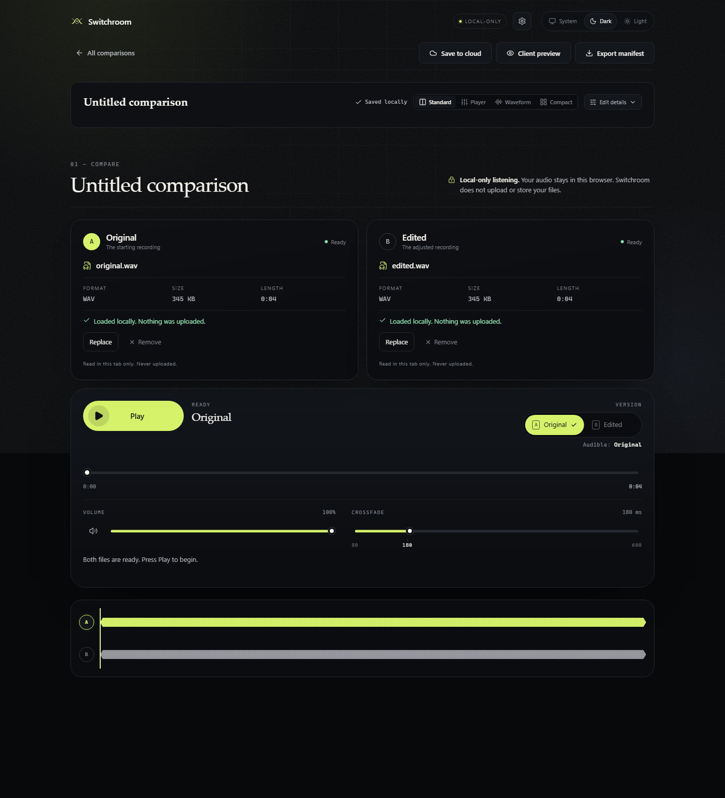
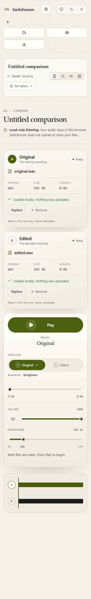

# Switchroom

**Hear the difference.** Switchroom is a local-first A/B audio player for comparing two versions of the same recording on one synchronized timeline. Load an Original and an Edited file, press Play, and switch between them mid-play through a real Web Audio crossfade, adjustable from 80 to 600 ms (180 ms by default).

**Live:** <https://switchroom.ftallfettah.workers.dev> (v0.6.0, deployed November 19, 2026)<br>
**v0.6.0:** Client sharing and guest review pages are live. Password-protected links remain disabled.

<div align="left">
  
  
  
</div>

## At a glance

|                             |                                                                                                                                                                                      |
| --------------------------- | ------------------------------------------------------------------------------------------------------------------------------------------------------------------------------------ |
| **Local-first comparison**  | Load Original and Edited files directly in the browser. Nothing is uploaded unless you explicitly save to cloud. Works offline.                                                      |
| **Synchronized A/B player** | One shared playhead, instant Original/Edited switching with a real Web Audio crossfade, timeline, waveforms, volume and keyboard control.                                            |
| **Private cloud projects**  | Save a comparison to a private Cloudflare R2 bucket via direct browser-to-R2 uploads (100 MB per file), with retention presets of 1–90 days.                                         |
| **Creator accounts**        | Optional sign-in with GitHub or Google (Better Auth on D1). Guest creators manage projects through a high-entropy capability link instead.                                           |
| **Client sharing (v0.6)**   | Generate public, unlisted or private invite review links with optional expiry and revocation. Clients open a link and listen — no account required. Password protection is deferred. |
| **Guest review page**       | A focused, responsive listening room: project title and description, Original/Edited labels, the synchronized player and nothing else.                                               |

## What's new in v0.6.0

**Client sharing and guest review pages.** A creator with an eligible cloud project (one ready Original and one ready Edited asset) can now share it:

- **Share dialog** (creator dashboard): choose visibility (Public / Unlisted / Private), optional link expiry capped by the project's retention, and create, copy, rotate or revoke links. Password protection is disabled in v0.6.
- **Public links** — anyone with the link can listen. Not indexed by default; indexing is an explicit opt-in per public project.
- **Unlisted links** — anyone with the high-entropy link can listen; never listed or indexed.
- **Private projects** — no primary link at all; clients join through invite links with independent expiry and revocation.
- **Guest review page** (`/review/<token>`): no account, no signup, no dashboard clutter. The client sees title, description, labels and the player, and can play, seek and switch versions while the playhead stays synchronized.
- **Short-lived playback URLs**: every play request re-runs server-side authorization and issues a temporary R2 presigned GET URL (5-minute target). The bucket and object keys stay private.
- **Link states**: invalid, revoked, expired and expired-project links show clear, privacy-safe unavailable screens.

Password-protected sharing is **deferred and disabled** for v0.6. The implementation remains unavailable until its password-hash cost, throttling and Worker runtime limits pass a security review. Public, unlisted and private invite links are available without a password gate.

v0.6 is listening-only: feedback votes, comments and downloads are deliberately not part of this release (v0.7–v0.8). The creator can preserve the corresponding preferences; they have no effect on the client page yet.

## Privacy guarantees

**Local comparison continues to work 100% offline with zero login, zero network, and zero cloud backend required.**

- Local files are read through the browser's `File` API and played from in-memory object URLs. No audio or metadata is sent to any server.
- Cloud saves require an explicit, user-initiated action. Switchroom never automatically uploads your audio.
- Cloud audio is stored in your private R2 bucket under opaque random object keys — never user filenames. Playback URLs are short-lived and issued only after a server-side authorization check.
- No analytics, no third-party scripts, no account required for anything.

## Supported files and codecs

Switchroom accepts `.wav`, `.mp3`, `.flac`, `.aac` and `.m4a` files. The extension gets the file to the browser's decoder; actual support depends on the browser and on the codec inside the container.

- WAV (PCM) and MP3 are the most broadly supported choices.
- FLAC support is good in current desktop Chromium and Firefox, but varies elsewhere.
- AAC and M4A support varies by platform. An `.m4a` file may contain codecs a given browser cannot decode.
- Switchroom never converts, transcodes or renames a file. If the browser cannot decode it, the affected slot shows a clear error and the other slot is unaffected.

## Browser support

The Playwright suite passes in Chromium and Firefox on Windows 11, covering local workspaces, cloud projects, file loading, playhead sync, A/B switching, gain automation, seeking, themes, keyboard access and reduced motion. Playwright WebKit passes UI/validation specs and skips audio-dependent specs on Windows because that build does not decode local audio in this environment.

Microsoft Edge on Windows 11 was used for the v0.1.0 manual listening pass against the public deployment with WAV files. Branded Chrome, branded Safari, Chrome Android and Safari iOS have **not** been manually verified. See [docs/browser-support.md](docs/browser-support.md) for the exact matrix, limitations and the listening record.

## Prerequisites

- Node.js 22.12 or newer. CI uses Node 24 via `.nvmrc`.
- npm 11 or newer.

## Local development

```bash
npm ci
npm run dev
```

Vite prints the local URL (usually `http://localhost:5173`). The development server exposes `window.__switchroom` (`{ engine, getContext }`) for automated diagnostics; production builds do not.

### Build and preview the production bundle

```bash
npm run build
npm run preview
```

`vite preview` runs the built output through the Cloudflare Vite plugin, so it exercises the Workers Static Assets runtime rather than a plain static server. The default preview URL is `http://localhost:4173`.

Run the smoke check against that preview:

```bash
npm run smoke
```

To check an already deployed site, point it at the public URL:

```bash
SMOKE_URL=https://your-site.workers.dev npm run smoke
```

On PowerShell:

```powershell
$env:SMOKE_URL = 'https://your-site.workers.dev'; npm run smoke
```

### Screenshots

With a preview server running on port 4173:

```bash
npm run screenshots
```

This writes `docs/screenshots/desktop-light.png`, `desktop-dark.png` and `mobile-360.png` from the real interface. Override the target with `SCREENSHOT_URL`.

## Tests and quality checks

```bash
npm run format:check   # Prettier
npm run lint           # ESLint
npm run typecheck      # TypeScript, strict, no emit
npm test               # Vitest unit/component tests
npm run test:e2e       # Playwright, Chromium fast gate
npm run test:e2e:all   # Playwright, Chromium + Firefox + WebKit
npm run test:e2e:ui    # Playwright UI mode
```

The source tree passes 255 Vitest tests across 28 files. The v0.6 sharing browser flow passes in Chromium. The Playwright suite generates its own deterministic WAV and failure fixtures in `tests/e2e/fixtures/` before each run; that folder is ignored by git. Regenerate them manually with `npm run fixtures`.

First-time Playwright setup:

```bash
npx playwright install chromium
# Optional, for the full local matrix:
npx playwright install firefox webkit
```

## Build and deploy

```bash
npm run build
npx wrangler login   # one-time, browser-based authentication
npm run deploy
```

The deploy command builds and uploads the static assets and Worker to Cloudflare. Full instructions, including CI secret setup and post-deploy checks, are in [docs/deployment.md](docs/deployment.md).

Never commit a Cloudflare token, `.env` file or any other credential.

### Sharing security notes (deployment)

Password-protected sharing is unavailable in v0.6. Do not set `SHARING_PASSWORD_PROTECTION_ENABLED`; it must remain off until an approved password-hashing implementation and its attempt throttling pass a security review and a benchmark in the deployed Worker runtime. The enabled path has not passed that release gate.

R2 playback requires a bucket CORS policy allowing `GET`/`HEAD` from your exact application origin(s); wildcard origins are not used in production.

## Project structure

```text
src/
  app/            App composition, providers and theme/workspace context
  audio/          Framework-independent A/B engine, gain math, validation
  components/     Layout, file slots, player controls and UI primitives (incl. share dialog)
  features/       Comparison workspace, home screen, presentation layouts, settings, client review
  hooks/          React bindings for player, playhead, workspace, preferences, theme
  styles/         Tokens, themes, base styles, layout presets and responsive components
  test/           Deterministic fake media/Web Audio host
  workspaces/     IndexedDB repositories, validation, manifest import/export
worker/
  index.ts        Hono app and route mounting
  routes/         API routes: health, auth, projects, uploads, assets, sharing
  services/       Auth, projects, uploads, R2 presigning, crypto, sharing
  migrations/     D1 migrations (0001 v0.5.0, 0002 v0.6.0 sharing)
tests/e2e/        Playwright specifications, helpers and generated fixtures
scripts/          Fixture generation, screenshot capture, preview smoke check
docs/             Engine, workspaces, manifest, decisions, deployment and support docs
```

## Documentation

- [Audio engine](docs/audio-engine.md) — graph, playhead policy, crossfade and resource lifecycle.
- [Waveform](docs/waveform.md) — peak pipeline, worker, resource budget, states and renderer.
- [Local workspaces](docs/local-workspaces.md) — IndexedDB storage model, privacy guarantees, relink workflow.
- [Workspace manifest](docs/workspace-manifest.md) — portable JSON format, validation rules, zero binary payloads.
- [Implementation decisions](docs/decisions.md) — scope, architecture and trade-offs.
- [Cloud architecture](docs/cloud-architecture.md) — Worker, D1, R2 and Better Auth deployment topology.
- [Local development](docs/local-development.md) — setup, scripts, fixtures and troubleshooting.
- [Deployment](docs/deployment.md) — Cloudflare, previews, secrets and post-deploy checks.
- [Browser support](docs/browser-support.md) — tested versions, codec caveats and manual listening status.

## Known limitations

- The two files do not need to be the same length, but comparison stops at the shorter duration. There is no silence padding.
- The crossfade is a linear-amplitude fade from 80 to 600 ms. Changing the duration affects the next switch, not a fade already in progress. The duration can be customized per workspace or set as a default in settings. If the two files have very different loudness, the transition will reflect that difference; Switchroom does not normalize loudness.
- Codec support is the browser's, not Switchroom's. AAC/M4A is the most variable.
- Waveform previews are a best-effort visual aid. PCM WAV is analysed directly; compressed formats depend on the browser decoder and may fall back to a plain timeline while playback still works.
- Switchroom stores comparison metadata in IndexedDB, but by design never persists audio file bytes. When reopening a workspace or reloading, files must be reselected from your disk.
- There are no global keyboard shortcuts. All controls are reachable with Tab and operable with standard keys, without stealing focus from browser or assistive-technology commands.
- Revoked links block new access immediately, but already-issued short-lived playback URLs may continue until they expire (bounded by their five-minute target).
- Automated browser coverage is desktop Chromium, Firefox and WebKit on Windows. Real mobile touch behaviour and branded Safari have not been verified.
- The only manual listening pass covered WAV files in Microsoft Edge on Windows 11 for v0.1.0. MP3, FLAC, AAC and M4A decode and listening behaviour, mobile touch, and Safari audio activation still need manual checks. Automated tests prove state transitions; they cannot prove that a transition sounds pleasant in every browser.

## Release notes

- **v0.6.0:** client sharing and guest review pages — public/unlisted/private invite links, link expiry and revocation, guest review page, short-lived playback URLs and share dialog. Password protection is deferred pending security/runtime review.
- **v0.5.1:** waveform color fix, lime button contrast, unified button sizing, RFC 7233 streaming headers, Web Audio CORS fix.
- **v0.5.0:** private cloud projects, direct R2 uploads, guest creator capabilities, Better Auth accounts.

[0.6.0]: https://github.com/Fettah010/switchroom/releases/tag/v0.6.0
[0.5.1]: https://github.com/Fettah010/switchroom/releases/tag/v0.5.1
[0.5.0]: https://github.com/Fettah010/switchroom/releases/tag/v0.5.0
[0.4.0]: https://github.com/Fettah010/switchroom/releases/tag/v0.4.0

## License

[MIT](LICENSE) © 2026 Switchroom contributors.
