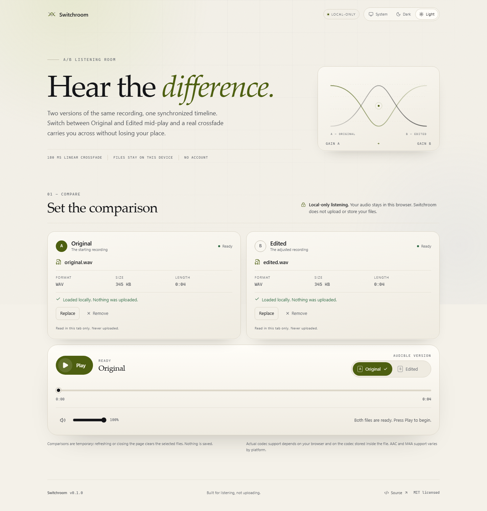

# Switchroom

**Hear the difference.** Switchroom is a local-first A/B audio player for comparing two versions of the same recording on one synchronized timeline. Load an Original and an Edited file, press Play, and switch between them mid-play through a real Web Audio crossfade, adjustable from 80 to 600 ms (180 ms by default).

**Live:** <https://switchroom.ftallfettah.workers.dev>

Your audio never leaves the browser. There is no account, no upload, no backend storage and no analytics.



## Project status

v0.5.0 is ready with private cloud persistence, direct R2 uploads, and optional creator accounts, alongside the complete local-first comparison experience. Automated test suites pass across Chromium and Firefox. See [Cloud Architecture](docs/cloud-architecture.md) and [Browser support](docs/browser-support.md).

## What v0.5 does

Everything in v0.4, plus:

- **Private cloud projects:** creators can explicitly choose **Save to cloud** to store A/B comparisons in a private, encrypted Cloudflare R2 bucket without proxying audio bytes through the Worker.
- **Direct browser-to-R2 upload:** short-lived S3-compatible SigV4 presigned PUT URLs (`aws4fetch`) allowing browser-direct uploads with zero audio byte proxying.
- **Server-side completion verification:** authoritative Cloudflare R2 `HEAD` check verifying object existence, exact byte size, and media MIME family before marking assets ready.
- **High-entropy Guest Creator capability:** guest mode creates private cloud projects with a cryptographically secure 256-bit owner capability (`sw_owner_<hex>`), stored only as a SHA-256 hash in D1.
- **Secure one-time recovery link:** one-time URL fragment `#owner=<secret>&project=<id>` displayed upon guest project creation; on load, the secret is exchanged for an `HttpOnly`, `SameSite=Lax` project cookie and immediately scrubbed from browser history and the URL bar via `history.replaceState`.
- **Creator accounts via Better Auth:** optional sign-in with GitHub and Google integrated with Cloudflare D1 (gracefully hidden when OAuth env vars are not configured).
- **Private creator dashboard:** modal view listing cloud projects, asset statuses (`pending`, `uploading`, `ready`, `failed`), retention countdown, open in editor, and delete actions.
- **Streamed cloud playback:** owner-authorized temporary presigned GET URLs streamed directly into `ABAudioEngine` with HTTP Range support for instant comparison without re-downloading entire files.
- **Retention presets:** customizable retention of 1, 7, 14, 30, 60, or 90 days (default: 30 days) with remaining time countdown.
- **100 MB per-file quota enforcement:** centralized quota policy strictly enforced in client preflight, upload session initialization, and server-side verification.
- **Strict scope boundaries:** No client sharing (`/api/share/*`), public review pages, comments, client downloads, or cron purges are in v0.5.0 (scheduled for v0.6–v0.9).

## Privacy and Offline Guarantees

**Local comparison continues to work 100% offline with zero login, zero network, and zero cloud backend required.**

- When using local comparisons, files are read through the browser's `File` API and played from in-memory object URLs. No audio or metadata is sent to any server.
- Cloud saves require an explicit, user-initiated action. Switchroom never automatically uploads your audio.
- In cloud mode, audio files are stored in your private R2 bucket with object keys containing opaque random UUIDs—never user filenames or predictable paths.

## Supported files and codecs

Switchroom accepts `.wav`, `.mp3`, `.flac`, `.aac` and `.m4a` files. The extension gets the file to the browser's decoder; actual support depends on the browser and on the codec inside the container.

- WAV (PCM) and MP3 are the most broadly supported choices.
- FLAC support is good in current desktop Chromium and Firefox, but varies elsewhere.
- AAC and M4A support varies by platform. An `.m4a` file may contain codecs a given browser cannot decode.
- Switchroom never converts, transcodes or renames a file. If the browser cannot decode it, the affected slot shows a clear error and the other slot is unaffected.

## Browser support

The 40-spec Playwright suite passes in full in Chromium and Firefox on Windows 11, covering local workspaces, IndexedDB persistence, manifest import/export, presentation layouts, client preview, file loading, playhead sync, A/B switching, gain automation, seeking while paused and playing, startup cancellation, rapid reversals, fade interruption, context interruption recovery, replace/remove cycles, crossfade duration changes, real waveform rendering, shared-axis seek, mismatch clipping, slider geometry, themes, keyboard access and reduced motion. Playwright WebKit passes UI/validation specs and skips audio-dependent specs on Windows because that build does not decode local audio in this environment.

Microsoft Edge on Windows 11 was used for the v0.1.0 manual listening pass against the public deployment with WAV files. Branded Chrome, branded Safari, Chrome Android and Safari iOS have **not** been manually verified, and no human listening pass has been recorded for v0.2.0, v0.3.0, or v0.4.0. Playwright WebKit is not identical to branded Safari. See [docs/browser-support.md](docs/browser-support.md) for the exact matrix, limitations and the listening record.

## Prerequisites

- Node.js 22.12 or newer. CI uses Node 24 via `.nvmrc`.
- npm 11 or newer.

## Local development

```bash
npm ci
npm run dev
```

Vite prints the local URL (usually `http://localhost:5173`). The development server exposes `window.__switchroom` (`{ engine, getContext }`) for automated diagnostics; production builds do not.

### Build and preview the production bundle

```bash
npm run build
npm run preview
```

`vite preview` runs the built output through the Cloudflare Vite plugin, so it exercises the Workers Static Assets runtime rather than a plain static server. The default preview URL is `http://localhost:4173`.

Run the smoke check against that preview:

```bash
npm run smoke
```

To check an already deployed site, point it at the public URL:

```bash
SMOKE_URL=https://your-site.workers.dev npm run smoke
```

On PowerShell:

```powershell
$env:SMOKE_URL = 'https://your-site.workers.dev'; npm run smoke
```

## Tests and quality checks

```bash
npm run format:check   # Prettier
npm run lint           # ESLint
npm run typecheck      # TypeScript, strict, no emit
npm test               # Vitest unit/component tests
npm run test:e2e       # Playwright, Chromium fast gate
npm run test:e2e:all   # Playwright, Chromium + Firefox + WebKit
npm run test:e2e:ui    # Playwright UI mode
```

The v0.4.0 source tree passes 223 Vitest tests across 21 files, 40 Chromium Playwright specs and 40 Firefox specs. WebKit reports 5 passed and 35 skipped on Windows for the environment reason above.

The Playwright suite generates its own deterministic WAV and failure fixtures in `tests/e2e/fixtures/` before each run; that folder is ignored by git. Regenerate them manually with `npm run fixtures`.

First-time Playwright setup:

```bash
npx playwright install chromium
# Optional, for the full local matrix:
npx playwright install firefox webkit
```

### Screenshots

With a preview server running on port 4173:

```bash
npm run screenshots
```

This writes `docs/screenshots/desktop-light.png`, `desktop-dark.png` and `mobile-360.png` from the real interface. Override the target with `SCREENSHOT_URL`.

## Build and deploy

```bash
npm run build
npx wrangler login   # one-time, browser-based authentication
npm run deploy
```

The deploy command builds and uploads the static assets to Cloudflare Workers. The current v0.4.0 deployment is <https://switchroom.ftallfettah.workers.dev>; Wrangler also prints the URL and the Cloudflare dashboard records it. Full instructions, including CI secret setup and post-deploy checks, are in [docs/deployment.md](docs/deployment.md).

Never commit a Cloudflare token, `.env` file or any other credential.

## Project structure

```text
src/
  app/            App composition, providers and theme/workspace context
  audio/          Framework-independent A/B engine, gain math, validation
  components/     Layout, file slots, player controls and UI primitives
  features/       Comparison workspace, home screen, presentation layouts, settings
  hooks/          React bindings for player, playhead, workspace, preferences, theme
  styles/         Tokens, themes, base styles, layout presets and responsive components
  test/           Deterministic fake media/Web Audio host
  workspaces/     IndexedDB repositories, validation, manifest import/export
tests/e2e/        Playwright specifications, helpers and generated fixtures
scripts/          Fixture generation, screenshot capture, preview smoke check
docs/             Engine, workspaces, manifest, decisions, deployment and support docs
```

## Documentation

- [Audio engine](docs/audio-engine.md) — graph, playhead policy, crossfade and resource lifecycle.
- [Waveform](docs/waveform.md) — peak pipeline, worker, resource budget, states and renderer.
- [Local workspaces](docs/local-workspaces.md) — IndexedDB storage model, privacy guarantees, relink workflow.
- [Workspace manifest](docs/workspace-manifest.md) — portable JSON format, validation rules, zero binary payloads.
- [Implementation decisions](docs/decisions.md) — scope, architecture and trade-offs.
- [Local development](docs/local-development.md) — setup, scripts, fixtures and troubleshooting.
- [Deployment](docs/deployment.md) — Cloudflare, previews, secrets and post-deploy checks.
- [Browser support](docs/browser-support.md) — tested versions, codec caveats and manual listening status.

## Known limitations

- The two files do not need to be the same length, but comparison stops at the shorter duration. There is no silence padding.
- The crossfade is a linear-amplitude fade from 80 to 600 ms. Changing the duration affects the next switch, not a fade already in progress. The duration can be customized per workspace or set as a default in settings. If the two files have very different loudness, the transition will reflect that difference; Switchroom does not normalize loudness.
- Codec support is the browser's, not Switchroom's. AAC/M4A is the most variable.
- Waveform previews are a best-effort visual aid. PCM WAV is analysed directly; compressed formats depend on the browser decoder and may fall back to a plain timeline while playback still works.
- Switchroom stores comparison metadata in IndexedDB, but by design never persists audio file bytes. When reopening a workspace or reloading, files must be reselected from your disk.
- There are no global keyboard shortcuts. All controls are reachable with Tab and operable with standard keys, without stealing focus from browser or assistive-technology commands.
- Automated browser coverage is desktop Chromium, Firefox and WebKit on Windows. Real mobile touch behaviour and branded Safari have not been verified.
- The only manual listening pass covered WAV files in Microsoft Edge on Windows 11 for v0.1.0. The 80–600 ms range, interruption recovery, waveforms, and the v0.2.0–v0.4.0 builds have not been listened to by a human. MP3, FLAC, AAC and M4A decode and listening behaviour, mobile touch, and Safari audio activation still need manual checks. Automated tests prove gain scheduling, playhead continuity, waveform pixels and state transitions; they cannot prove that a transition sounds pleasant in every browser.

## License

[MIT](LICENSE) © 2026 Switchroom contributors.
