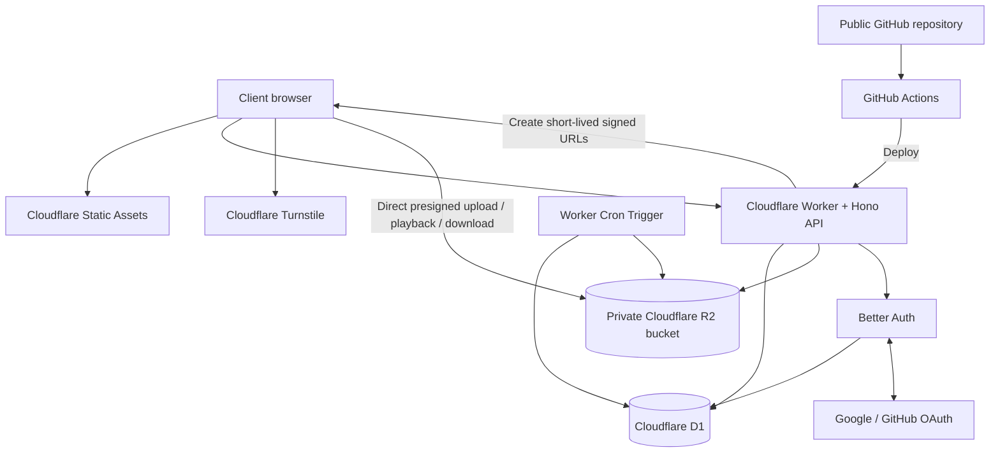

# Switchroom — Open-Source Audio A/B Review Tool

> **Working title:** Switchroom (rename before creating the public repository if desired)  
> **Document type:** Product, architecture, design and agent-ready release plan  
> **Research checked:** 8 November 2026  
> **Target:** A public, full-stack web application for presenting original/edited audio comparisons to clients  
> **Cost target:** $0/month for the intended low-traffic launch, using free tiers only. Free-tier quotas are finite and can change; this is not a promise of unlimited free hosting.

---

## 1. Product definition

Switchroom is a minimal, highly polished audio-review website. A creator places an **Original** recording and an **Edited** recording into one comparison project, then shares a presentation-quality link with a client. The client can switch between the two versions while playback stays at the same point in the recording, hear a smooth transition, choose a preferred version, download the audio when permitted, and leave timestamped comments with replies.

The first release must already be useful without an account, database or cloud upload. It starts as a local-first comparison tool. Later releases add cloud projects, optional accounts, guest access, sharing, feedback, downloads and automatic deletion. Each release remains deployable and usable; no milestone is allowed to leave the public site broken while a future milestone is being built.

### Product principles

1. **The comparison is the product.** A/B switching must be immediate, synchronized and musically smooth. This is not a general-purpose DAW or audio editor.
2. **Client-first presentation.** The shared page should look like a designed listening experience, not an admin panel or a debug tool.
3. **No mandatory client account.** A client should be able to open a link and listen. Accounts add convenience, not a barrier.
4. **Local-first, cloud when requested.** Local comparison works without uploading audio. Cloud storage is an explicit project action.
5. **Privacy by default.** Links are unlisted by default, downloads and feedback are creator-controlled, and cloud projects expire automatically.
6. **Minimal but expressive.** Motion, depth, scroll effects and backgrounds should add atmosphere and feedback without making the interface noisy or slow.
7. **Free-service discipline.** Avoid a service just because it has a free tier. Prefer fewer services, explicit quotas, app-level limits and graceful failure.

### Out of scope for v1.0

- Multitrack editing, mixing, EQ, compression, mastering or waveform editing.
- Server-side audio transcoding or audio enhancement.
- AI transcription, AI summaries or paid APIs.
- Team workspaces, billing, subscriptions or a commercial storage promise.
- Public music hosting, discovery feeds or an indexed library of user uploads.
- A promise that every codec inside every file extension will play in every browser.

---

## 2. Confirmed requirements

These are the decisions supplied for this plan and should be treated as product requirements.

| Area             | Decision                                                                                                                |
| ---------------- | ----------------------------------------------------------------------------------------------------------------------- |
| Comparison model | **Synchronized A/B player**: one timeline and transport; switch Original/Edited without resetting the playhead.         |
| Transition       | Smooth crossfade when changing versions.                                                                                |
| Audio formats    | WAV, MP3, FLAC, AAC and M4A.                                                                                            |
| Sharing          | Public, unlisted, password-protected and private/expiring link modes.                                                   |
| Client feedback  | Choose preferred version; download audio when allowed; reply to comments; timestamped comments.                         |
| Accounts         | Optional accounts for both creators and clients; guest access must remain available.                                    |
| Retention        | Automatically delete cloud projects after a creator-selected period.                                                    |
| Stack            | Select the best architecture for performance, free hosting and maintainability.                                         |
| Visual direction | Premium minimal / experimental: creative composition, atmospheric backgrounds, beautiful transitions and subtle motion. |
| Themes           | Dark and light; follow the operating-system preference by default. Allow an explicit manual override.                   |
| Public source    | Public GitHub repository and public deployment.                                                                         |

### Product assumptions used to make the plan buildable

- Cloud projects default to **30 days** of retention. The creator can select 1, 7, 14, 30, 60 or 90 days. The free launch should cap cloud retention at 90 days to protect the small storage pool. Local-only comparisons do not need server-side expiry.
- Initial cloud upload limit: **100 MB per audio file**. Raise it only after resumable multipart uploads are implemented and tested. The application also enforces a shared storage budget below the provider's free allowance.
- Modern desktop Chrome, Edge, Firefox and Safari are the primary target browsers. Mobile Safari and Chrome are supported with explicit testing, not assumptions.
- Google and GitHub OAuth are the default sign-in options. Email/password and email notifications are not required for v1.0 because reliable outbound email requires an additional sending provider and sender-domain configuration.
- No custom domain is required. The first public deployment can use a Cloudflare `workers.dev` address. Buying a domain is optional and not part of the free-cost promise.

---

## 3. Main user journeys

### 3.1 Creator: local comparison

1. Open the public website.
2. Choose **Create comparison**.
3. Add the Original audio file and the Edited audio file using drag-and-drop or file pickers.
4. The browser checks file type, size, metadata and actual playback compatibility.
5. The comparison player appears with one timeline, one play/pause control and clear Original/Edited selection.
6. Press play and switch versions while audio continues at the same timestamp.
7. Adjust crossfade duration and preview the result.
8. Use the tool without creating an account or uploading either file.

### 3.2 Creator: save and share a cloud project

1. Select **Save to cloud**.
2. Continue as a guest or sign in with Google/GitHub.
3. Name the project and select its retention period.
4. Upload both files directly to private R2 storage.
5. Choose visibility and client permissions.
6. Generate a share link and copy it.
7. See project expiry, storage use, feedback and link status in the creator dashboard.
8. Revoke links or delete the project at any time.

### 3.3 Client: review a shared comparison

1. Open the shared link; no account is required for basic listening.
2. See the project title, creator labels and clean A/B player.
3. Listen, switch versions and seek through the shared timeline.
4. Select the preferred version if feedback is enabled.
5. Download Original and/or Edited only when the creator permits it.
6. Add a timestamped comment and reply to a thread if feedback is enabled.
7. Optionally sign in to keep a client identity across devices; never force signup just to listen.

---

## 4. Free-first architecture recommendation

### 4.1 Recommended stack

Use a **Cloudflare-first application** with one deployment surface and as few vendors as possible.

| Layer             | Choice                                               | Purpose                                                     | Why this choice                                                                                |
| ----------------- | ---------------------------------------------------- | ----------------------------------------------------------- | ---------------------------------------------------------------------------------------------- |
| Frontend          | React + TypeScript + Vite                            | Interactive comparison UI                                   | Mature ecosystem, strong typing, straightforward SPA delivery.                                 |
| UI styling        | Tailwind CSS plus custom CSS tokens/components       | Responsive design system                                    | Fast layout iteration without accepting a generic component-library look.                      |
| Motion            | Motion for React (`motion`) + CSS transitions        | Page, scroll and interaction animation                      | React-native animation primitives; can respect reduced-motion settings.                        |
| Audio engine      | HTMLAudioElement + Web Audio API                     | Dual synchronized decks and crossfade                       | Streams audio through browser media elements instead of decoding every file fully into memory. |
| API               | Cloudflare Worker + Hono                             | Auth callbacks, project APIs, signed URLs and access checks | Runs beside the static app; no separate server to host.                                        |
| Static hosting    | Cloudflare Workers Static Assets / Vite plugin       | Public website and SPA assets                               | One deploy publishes static assets and Worker code together.                                   |
| Database          | Cloudflare D1 (SQLite)                               | Users, projects, links, comments, votes and expiry metadata | Native Worker binding and a usable free allowance.                                             |
| Object storage    | Cloudflare R2 Standard                               | Original and edited audio files                             | S3-compatible, direct browser upload, no Internet egress fee.                                  |
| Authentication    | Better Auth with D1                                  | Optional Google/GitHub accounts                             | Better Auth has first-class D1 support; no separate hosted auth vendor required.               |
| Bot protection    | Cloudflare Turnstile                                 | Guest project creation and abuse-sensitive feedback actions | Free plan is available for most production applications.                                       |
| CI                | GitHub Actions (public repository, standard runners) | Lint, tests, build and deploy                               | Standard GitHub-hosted runner usage is free for public repositories.                           |
| Scheduled cleanup | Cloudflare Worker Cron Trigger                       | Expired project and R2 object cleanup                       | Runs the deletion job without an external scheduler.                                           |

**Do not add Supabase to the first architecture.** D1 already covers the relational metadata and Better Auth can use D1 directly. Supabase would add another provider and operational surface. Its current Free projects can pause after a period of low activity, which is undesirable for a public client-facing service. Supabase remains a valid alternative if the project later needs hosted Postgres or its specific features, but it is not needed for this product's v1.0.

### 4.2 Architecture overview



### 4.3 Why direct-to-R2 uploads matter

Do not stream 100 MB audio files through the Worker API. The Worker should authorize the upload and issue a short-lived, single-object presigned URL. The browser uploads the file directly to R2. After upload, the browser asks the Worker to finalize; the Worker checks that the expected object exists and that the size/type match the upload session before marking the asset ready.

This avoids using the Worker as a large-file proxy and avoids exposing R2 access keys in browser code. Generate signatures in the Worker with a small SigV4-compatible helper such as `aws4fetch` (or the AWS SDK with the required Worker compatibility settings): the R2 Workers binding itself does not create S3 presigned URLs. Presigned URLs are bearer credentials: keep them short-lived, restrict the permitted method/object/content type, and never store them as permanent share links.

R2 browser access requires a deliberately configured CORS policy for the application's exact origin. Do not make the whole bucket public. The playback page should request temporary GET access only after the share permissions have been checked.

### 4.4 Free-tier budget and safety limits

The values below are the current published allowances checked on 8 November 2026. Provider limits can change. Recheck them before deployment and periodically thereafter.

| Service                | Current free allowance relevant to this app                                                                                                                                | App-side rule                                                                                                                                                          |
| ---------------------- | -------------------------------------------------------------------------------------------------------------------------------------------------------------------------- | ---------------------------------------------------------------------------------------------------------------------------------------------------------------------- |
| Cloudflare Workers     | 100,000 dynamic requests/day and 10 ms CPU time per invocation on Free. Static asset requests are free and unlimited. Free accounts currently allow up to 5 Cron Triggers. | Keep API handlers small; never decode or transcode audio inside a Worker. Cache public static assets and use one cleanup schedule.                                     |
| Cloudflare D1          | 5 million rows read/day, 100,000 rows written/day, 500 MB maximum per free database and 5 GB total free account storage.                                                   | Store metadata only; index project/share lookups; paginate comments; avoid unbounded queries.                                                                          |
| Cloudflare R2 Standard | 10 GB-month storage, 1 million Class A operations/month and 10 million Class B operations/month; Internet egress is free.                                                  | Set a hard application storage ceiling around 8–8.5 GB, leaving headroom for temporary uploads and cleanup. Reject new uploads cleanly when the app budget is reached. |
| Cloudflare Turnstile   | Free plan supports unlimited challenges/verification requests, with up to 20 widgets per account.                                                                          | Use one production widget for guest-sensitive actions; do not challenge every normal page view.                                                                        |
| GitHub Actions         | Standard GitHub-hosted runner usage is free for public repositories.                                                                                                       | Keep workflow artifacts small; never put credentials in repository files or logs.                                                                                      |
| Resend (optional only) | Free plan currently lists 3,000 emails/month and 100/day.                                                                                                                  | Do not make email necessary for core workflows. Add only if notifications are genuinely needed and a sender domain is configured.                                      |

**Important cost behaviour:** a free tier is a quota, not infinite capacity. Some services reject work after the free quota; R2 storage and operation overages may become billable if billing is enabled. Before enabling billing on any provider, review its current overage behaviour. Keep app-level quotas below provider limits, disable unnecessary paid upgrades, and show storage/usage warnings in the owner dashboard.

### 4.5 Why not use GitHub Pages as the application host?

GitHub Pages can host a static frontend, but the project needs server-side authorization, signed storage URLs, account callbacks, feedback writes and scheduled cleanup. Hosting the React assets and API Worker together on Cloudflare avoids stitching a separate frontend host to a backend host. GitHub remains the source repository and CI system.

### 4.6 Optional email, not a core dependency

The core v1.0 product must work without outbound email. Google/GitHub OAuth handles optional login; the creator can copy the share link manually. If email notifications are later requested, add an adapter interface and optionally configure Resend's free tier. Do not assume Cloudflare Email Routing is a general-purpose free outbound email provider: its current free plan does not allow sending to arbitrary recipients through Email Sending.

---

## 5. Audio engine design

### 5.1 Core behaviour

The player uses two media elements:

- **Deck A:** Original audio.
- **Deck B:** Edited audio.

Both are connected to their own `GainNode` in a shared `AudioContext`. The active deck is audible; the inactive deck is muted. When a listener switches versions:

1. Keep the canonical playhead time unchanged.
2. Ensure the inactive deck is ready and seek it to the canonical time.
3. If it is not ready, wait for it to seek/settle; do not jump the visible timeline.
4. Ramp the new deck's gain up while ramping the old deck down.
5. Change the active-version indicator when the transition begins or completes, consistently.
6. Continue the shared play/pause state.

Use scheduled `AudioParam` automation for the gain ramps. Start with a **180 ms crossfade**, adjustable from approximately 80 ms to 600 ms in the player. Use an equal-power transition curve when it produces the least perceptible dip; validate with real audio rather than assuming a mathematically smooth curve will sound best for every pair.

Do not use a CSS opacity fade as an audio transition. Visual animation and the audio gain curve are separate systems.

### 5.2 Playback state

Maintain one authoritative transport state:

- `isPlaying`
- `currentTime`
- `duration`
- `activeVersion` (`original` or `edited`)
- `volume`
- `playbackRate`
- `crossfadeMs`
- `isSeeking`
- `isLoadingA` / `isLoadingB`
- `isAudioContextReady`
- per-deck media errors

Do not let both media elements independently drive the visible timeline. Use one canonical transport controller and keep the inactive deck synchronized. Guard against repeated switch clicks, seek races, metadata not loaded, and a deck that fails to play.

### 5.3 File format and codec policy

Accept these extensions/MIME families:

| User format | Expected media                  | Compatibility note                                                                                                    |
| ----------- | ------------------------------- | --------------------------------------------------------------------------------------------------------------------- |
| WAV         | PCM WAVE                        | Broad browser support for common PCM WAV files.                                                                       |
| MP3         | MPEG Layer III                  | Broad browser support.                                                                                                |
| FLAC        | Native FLAC                     | Supported by current mainstream browsers, but test older mobile/embedded browser versions.                            |
| AAC         | Raw AAC/ADTS (`.aac`)           | **Not consistently supported on every browser/platform.** Feature-detect and test actual playback.                    |
| M4A         | Usually AAC in an MP4 container | AAC-in-MP4 is much more reliable than assuming every M4A file is AAC; M4A can also contain other codecs such as ALAC. |

A file extension is not proof of the codec inside it. Use file signatures where practical, `HTMLMediaElement.canPlayType()` as a preliminary capability check, and actual metadata/load/play error handling as the final check. Tell the user exactly which file is incompatible. Never silently change the user's audio.

Do not promise universal AAC/ALAC playback in v1.0. If consistent raw AAC support becomes essential, evaluate an optional on-demand browser-side WASM decoder/transcoder in a later release. It must be lazy-loaded, disabled on low-memory devices unless requested, and must not delay the normal MP3/WAV/FLAC/M4A path.

### 5.4 Time and duration differences

- Use the same absolute timestamp for both versions.
- If durations differ, use the shorter valid duration for the common comparison timeline in v1.0 and show a visible duration-difference notice.
- Never silently stretch, time-warp or resample either recording.
- A later alignment-offset feature can be considered only after the basic A/B engine is reliable.

### 5.5 Streaming and memory

Use `HTMLAudioElement` for normal playback and `MediaElementAudioSourceNode` for gain control. Do not eagerly decode the entire file into an `AudioBuffer` just to play it; that can use substantial memory for long or high-resolution WAV files. Waveform generation is a separate process with a size threshold and a linear-timeline fallback.

### 5.6 Player controls

Required by v1.0:

- Play/pause and keyboard-accessible controls.
- One seek bar/timeline.
- Original/Edited toggle or A/B buttons.
- Crossfade amount control (with a sensible default).
- Volume/mute.
- Current time and duration.
- Active version label that remains obvious during playback.
- Loading, unsupported-file and playback-error states.
- Optional speed control only if it does not compromise synchronized switching.
- Keyboard shortcuts with conflict-free focus handling.

---

## 6. Information architecture and screens

### Public pages

1. **Landing page** — concise product explanation, animated preview of A/B switching, Create comparison CTA, privacy statement.
2. **Compare workspace** — upload slots, player, timeline/waveform, metadata, notes and cloud-save action.
3. **Shared review page** — client-focused listening page with no dashboard clutter.
4. **Sign-in page/modal** — optional Google/GitHub sign-in and continue-as-guest path.
5. **Expired/revoked page** — clear explanation without exposing private project metadata.
6. **Privacy and project-retention page** — what is stored, how long it stays and how it is deleted.

### Creator dashboard

- Project list with status, last activity and expiry countdown.
- New comparison action.
- Project title and labels.
- Original and Edited asset status.
- Sharing/visibility controls.
- Download and feedback permissions.
- Client preference summary and comment thread.
- Link revocation and project deletion.
- Account settings and theme preference.
- Storage usage meter and free-tier cap warning.

### Client review page

- Project title and optional short description.
- Prominent A/B switcher.
- One timeline and play/pause control.
- Minimal waveform where available.
- Client preference control.
- Timestamped comments and threaded replies, if enabled.
- Download buttons only when allowed.
- Expiry notice when appropriate.
- No signup wall for basic viewing/listening.

---

## 7. Visual and interaction system

### 7.1 Visual language

**Direction:** premium minimal / experimental. Think an editorial audio instrument rather than a typical SaaS dashboard.

- Dark theme: deep charcoal/ink background, soft near-white typography, muted cool surfaces and one restrained signal accent.
- Light theme: warm off-white/paper background, dark graphite typography, quiet borders and the same accent adjusted for contrast.
- Use a clear display typeface for large project titles and a highly legible sans-serif for controls and metadata. Avoid decorative type for small labels.
- Use a strong grid, deliberate asymmetry, generous negative space and precise alignment.
- Use thin rules, soft radial/mesh gradients, quiet noise/grain and subtle topographic or frequency-inspired line patterns.
- Avoid overusing glassmorphism, glossy gradients, giant blur panels, glowing borders or generic dashboard cards.
- Audio waveforms should be functional and readable, not just decorative.

### 7.2 Theme behaviour

- Initial setting: `system` (`prefers-color-scheme`).
- User can explicitly select System / Dark / Light.
- Store an explicit override locally and restore it on future visits.
- Shared client pages should follow the viewer's system theme unless the creator selects a deliberately fixed presentation theme in a later optional setting.
- Check contrast in both themes and never encode active A/B state by colour alone.

### 7.3 Motion language

Motion should feel deliberate and responsive, not constantly moving for attention.

| Interaction           | Motion target                                                                                             |
| --------------------- | --------------------------------------------------------------------------------------------------------- |
| Page/route transition | 180–280 ms; mostly opacity and small positional movement.                                                 |
| Panel/modal open      | 180–240 ms with subtle spring settling.                                                                   |
| Button press          | 80–140 ms tactile scale/position feedback.                                                                |
| A/B visual state      | Immediate label/indicator change with a short 120–200 ms visual transition; audio uses its own gain ramp. |
| Scroll reveal         | 12–20 px movement maximum, staggered lightly; no scroll hijacking.                                        |
| Background atmosphere | Slow, low-contrast movement; pause or simplify when the tab is hidden.                                    |
| Waveform seek         | Immediate response; animation must not delay seeking.                                                     |
| Upload progress       | Real progress from byte counts, not an invented looping percentage.                                       |

Use Motion for React for interactive/page/scroll choreography and CSS for simple hover/focus states. Support `prefers-reduced-motion`: disable parallax, scroll reveals and nonessential looping effects while preserving state feedback and functional audio transitions. Do not autoplay sound or use a background video as the main visual effect.

### 7.4 Interaction details

- Drag-and-drop zones respond with a quiet outline/fill shift and a short success confirmation.
- Clicking A/B controls produces immediate tactile feedback.
- Copy-link action shows a small confirmation near the control.
- Share-setting changes show a clear saved/unsaved state.
- Upload states distinguish queued, uploading, verifying, ready and failed.
- Empty states should demonstrate the two audio slots, not show generic empty rectangles.
- On mobile, controls should remain reachable with one thumb; no hover-only affordances.

### 7.5 Performance rules

- Avoid WebGL and heavy canvas scenes for the background.
- Keep waveform drawing isolated from player state updates; use `requestAnimationFrame` only while necessary.
- Avoid rerendering the entire page on every audio `timeupdate` event.
- Throttle UI progress updates while audio plays.
- Lazy-load optional visualizations and any future WASM decoder.
- Respect reduced-motion and low-power constraints.

---

## 8. Sharing, privacy and guest identity

### 8.1 Share modes

Treat visibility, password and expiry as separate settings so they can be combined cleanly.

1. **Public:** anyone who reaches the public project URL can view it. Search indexing should be an explicit opt-in; default `noindex` even for public projects.
2. **Unlisted:** anyone with a high-entropy share URL can view it; the URL is not listed or indexed.
3. **Password protected:** an unlisted URL plus a separately entered password. Do not put the password in the URL.
4. **Private / invite link:** a specific random invite token with its own expiry and revocation state. It can be view-only or allow feedback according to its scope.

The creator can also set link expiration independently from project retention. A link can expire before the project does. Revoking a link must take effect at the next access check.

### 8.2 Guest creator access

Guest creator mode needs a secure recovery mechanism. On cloud-project creation, issue a high-entropy owner capability secret. Store only a cryptographic hash of the secret. Give the creator a clearly named **Save your project-owner link** step; explain that clearing browser data or losing the secret can make an unclaimed guest project unrecoverable. Allow the creator to claim the project after signing in.

Never reuse the client share token as an owner-management token. The owner capability must have management scope; client links must not grant project editing or deletion.

### 8.3 Guest client identity

Guests may listen without entering personal information. To comment or vote, ask for a display name; issue a random project-scoped guest identity in a secure, HttpOnly cookie. Make it clear that a guest display name is not a verified legal identity. A signed-in client can optionally attach feedback to their account.

### 8.4 Password protection

Do not invent a password scheme or store plaintext passwords. Use a reviewed password-hashing design compatible with the Worker runtime, apply per-link attempt throttling and progressive challenge protection, and test it against the Free CPU budget. Never substitute a fast unsalted SHA-256 hash. If a suitable safe implementation cannot fit the free Worker runtime, keep password-protected sharing disabled until the design is corrected rather than shipping weak security.

### 8.5 Permission matrix

| Action                          |         Owner |               Guest client |                         Signed-in client |
| ------------------------------- | ------------: | -------------------------: | ---------------------------------------: |
| Listen                          |           Yes |       Yes, if link permits |                     Yes, if link permits |
| Switch A/B and seek             |           Yes |                        Yes |                                      Yes |
| Download                        |  Owner always |          Only when enabled |                        Only when enabled |
| Vote preferred version          | Yes / preview | Only when feedback enabled |               Only when feedback enabled |
| Add timestamped comment         |           Yes | Only when feedback enabled |               Only when feedback enabled |
| Reply to comments               |           Yes | Only when feedback enabled |               Only when feedback enabled |
| Change title/assets/permissions |           Yes |                         No | No, unless separately granted owner role |
| Revoke links / delete project   |           Yes |                         No |                         No, unless owner |

---

## 9. Data model (D1)

Store metadata and access state in D1. Store audio bytes only in R2. Never put audio blobs in D1 rows.

### Core tables

| Table                            | Main fields                                                                                                                                                                                                                                 | Purpose                                                                |
| -------------------------------- | ------------------------------------------------------------------------------------------------------------------------------------------------------------------------------------------------------------------------------------------- | ---------------------------------------------------------------------- |
| Better Auth tables               | Users, sessions, accounts, verification records                                                                                                                                                                                             | Managed by Better Auth migrations.                                     |
| `projects`                       | `id`, `owner_user_id` nullable, `owner_capability_hash` nullable, `title`, `description`, `status`, `visibility`, `password_hash` nullable, `feedback_enabled`, `downloads_enabled`, `created_at`, `updated_at`, `expires_at`, `deleted_at` | Project ownership, settings and retention.                             |
| `audio_assets`                   | `id`, `project_id`, `role` (`original`/`edited`), `object_key`, `filename`, `mime_type`, `size_bytes`, `duration_ms`, `codec`, `status`, `checksum`, `created_at`                                                                           | Two version assets per project.                                        |
| `share_links`                    | `id`, `project_id`, `token_hash`, `scope`, `expires_at`, `revoked_at`, `created_at`                                                                                                                                                         | Unlisted and invite-specific link capabilities.                        |
| `participants`                   | `id`, `project_id`, `user_id` nullable, `display_name`, `guest_token_hash` nullable, `created_at`, `last_seen_at`                                                                                                                           | Guest or signed-in client identity inside a project.                   |
| `comments`                       | `id`, `project_id`, `participant_id`, `parent_comment_id` nullable, `timestamp_ms` nullable, `body`, `created_at`, `updated_at`, `deleted_at`                                                                                               | Timestamped comment threads and replies.                               |
| `preferred_votes`                | `id`, `project_id`, `participant_id`, `choice`, `created_at`, `updated_at`                                                                                                                                                                  | Preferred-version selection; one current vote per participant/project. |
| `upload_sessions`                | `id`, `project_id`, `asset_id`, `object_key`, `expected_size`, `expected_mime`, `expires_at`, `status`                                                                                                                                      | Safe, idempotent upload finalization and abandoned-upload cleanup.     |
| `deletion_jobs`                  | `id`, `project_id`, `status`, `attempts`, `last_error_code`, `created_at`, `updated_at`                                                                                                                                                     | Retryable, idempotent R2 + D1 deletion.                                |
| `abuse_counters` (or equivalent) | Hashed subject/key, action, count, window, expiry                                                                                                                                                                                           | Basic rate limits for guest actions. Keep retention short.             |

### Database rules

- Use opaque random IDs; never expose incrementing project IDs as access credentials.
- Use foreign keys where supported and index `project_id`, `expires_at`, `token_hash`, `status` and comment thread lookups.
- Store token hashes, not raw share or owner secrets.
- Store timestamps in UTC as integer epoch milliseconds or a consistent ISO UTC representation.
- Enforce one Original and one Edited asset per comparison project in application/database logic.
- Use prepared statements only; validate all input on the Worker, not only in React.
- Use bounded pagination for comments and dashboard project lists.
- Because D1 is SQLite and does not provide interactive transactions, use its supported batch/atomic patterns and idempotent state transitions for multi-step operations. Do not assume Postgres transaction semantics.

---

## 10. API surface (Worker / Hono)

All write and permission-sensitive operations go through the Worker. The browser never receives database credentials, Better Auth secrets, R2 access keys or raw storage object keys.

| Route                              | Purpose                                                   | Introduced |
| ---------------------------------- | --------------------------------------------------------- | ---------- |
| `/api/health`                      | Minimal health/version status; no secrets or account data | v0.1       |
| `/api/auth/*`                      | Better Auth endpoints and OAuth callbacks                 | v0.5       |
| `/api/projects`                    | Create/list cloud projects                                | v0.5       |
| `/api/projects/:id`                | Read/update/delete an owned project                       | v0.5       |
| `/api/uploads/init`                | Create upload session and return short-lived R2 PUT URL   | v0.5       |
| `/api/uploads/:id/complete`        | Verify uploaded object and finalize asset                 | v0.5       |
| `/api/uploads/:id/cancel`          | Cancel session and remove unfinished object               | v0.5       |
| `/api/share/:token/access`         | Resolve a link and check its permissions                  | v0.6       |
| `/api/share/:token/playback/:role` | Issue a short-lived GET URL for an allowed asset          | v0.6       |
| `/api/projects/:id/links`          | Create, list and revoke links for the owner               | v0.6       |
| `/api/projects/:id/vote`           | Submit/update preferred-version vote                      | v0.7       |
| `/api/projects/:id/comments`       | Create/list timestamped comments                          | v0.7       |
| `/api/comments/:id/replies`        | Reply to a comment                                        | v0.7       |
| `/api/share/:token/download/:role` | Issue a permitted attachment download URL                 | v0.8       |
| `/api/uploads/multipart/*`         | Create, sign, complete and abort multipart uploads        | v0.8       |

### API security requirements

- Verify the current Better Auth session or the relevant scoped guest capability for every protected request.
- Check project expiry and link revocation on every share-page authorization, not only when the page first loads.
- Check the requested role (`original`/`edited`) against the asset attached to that project.
- Apply same-origin/CSRF protections to state-changing routes and secure cookie settings.
- Validate `Origin`, method, content type, body size and schema.
- Use short-lived presigned URLs; never return R2 secret keys or permanent public object URLs.
- Return generic access errors that do not reveal whether a private project ID exists.
- Keep server logs free of raw passwords, tokens, signed URLs, audio contents and unnecessary personal data.

---

## 11. Upload, playback and download lifecycle

### Upload lifecycle

1. Creator chooses Original or Edited and selects a local file.
2. Client checks extension, reported MIME, size, browser capability and local metadata.
3. Client requests an upload session from Worker.
4. Worker confirms ownership/guest capability, project status, expiry, quota and file limit.
5. Worker creates a random R2 object key and issues a short-lived presigned PUT URL for that exact object and content type.
6. Browser uploads directly to R2 and reports actual byte progress.
7. Browser calls `complete`; Worker verifies object existence and expected size/content type, then marks the asset ready.
8. If upload fails or is abandoned, cleanup removes its temporary object and upload-session metadata.

### Playback lifecycle

1. Client opens a public/unlisted/invite link.
2. Worker validates visibility, password state if applicable, link expiry, revocation and project expiry.
3. Worker returns only short-lived playback URLs for the Original and Edited objects that the link is allowed to access.
4. Browser loads both media elements and initializes audio only after a user gesture where required by browser autoplay policy.
5. Player synchronizes the inactive deck before switching and uses Web Audio gain automation for the transition.
6. When a signed URL expires, the player requests a fresh one and resumes from the same time where possible.

### Download lifecycle

1. The client presses a download action that is visible only when permitted.
2. Worker re-checks project/link permission and the selected asset.
3. Worker issues a short-lived attachment URL with a safe filename.
4. Download never depends on a permanent public bucket URL.

### Resumable uploads

The first cloud upload release uses one PUT per file and a 100 MB cap. Add multipart/resumable uploads later for larger files. Multipart handling must have explicit complete/abort paths and remove abandoned multipart uploads. The application's own maximum remains configurable and must never be raised simply because R2 technically accepts larger objects.

---

## 12. Ten-release roadmap: v0.1 → v1.0

**Release rule:** every milestone ends with a tagged, deployed, working release. Do not merge unfinished features into the main branch. Feature flags may hide work in progress, but the public release must remain usable.

### v0.1 — Public foundation and first working A/B player

**Purpose:** Ship something real immediately. A visitor can open the public website, compare two local audio files and hear the central A/B experience without an account.

**Build**

- Public GitHub repository with README, license decision, contribution notes and issue templates.
- React + TypeScript + Vite app deployed to Cloudflare Workers Static Assets.
- Responsive landing page and comparison workspace.
- Local drag-and-drop/file-picker slots for Original and Edited.
- Initial supported format filter: WAV, MP3, FLAC, AAC and M4A.
- One play/pause control, one timeline, current time and duration.
- Original/Edited switch with a basic 180 ms crossfade using Web Audio gain nodes.
- Clear loading, incompatible-file and missing-file states.
- System dark/light theme with manual override.
- Initial typography, spacing, buttons, ambient background and tasteful click/page motion.
- Basic keyboard operation and no autoplay audio.
- First GitHub Actions workflow: install, type-check, lint, test and build.

**Explicitly not in v0.1**

- No cloud upload, accounts, persistent server projects, share links or client comments.
- Local files stay in the visitor's browser; explain this visibly.

**Acceptance gate**

- A fresh visitor can load two files and play either version.
- Switching at a non-zero timestamp does not restart playback.
- The audio transition is audible as a smooth gain ramp, not just a visual animation.
- Dark/light/system settings work on desktop and mobile layouts.
- App is deployed publicly and repository contains instructions to run it locally.
- A clean `main` branch and tagged `v0.1.0` release exist.

### v0.2 — Reliable transport and precision switching

**Purpose:** Make the core player dependable enough for real client work.

**Build**

- Extract an audio transport/controller module separate from React rendering.
- Robust two-deck synchronization and seek handling.
- Adjustable crossfade duration with a stable default.
- Handle rapid repeated A/B switching without gain jumps or stuck decks.
- Handle pause/play during an in-progress fade.
- Handle one file loading slower than the other.
- Duration mismatch notice and shared timeline based on the shorter valid duration.
- Format capability checks with `canPlayType()` plus real load/error handling.
- Metadata panel: file name, duration, type and available technical details.
- Volume/mute and optional playback speed if synchronized switching remains correct.
- Keyboard shortcuts and visible focus states.
- Add automated audio-controller tests using deterministic fixture files.

**Acceptance gate**

- Repeat switching, seek, pause and resume do not desynchronize the decks.
- Unsupported codec failures explain which file needs attention.
- No uncaught errors from missing metadata, zero-length files or malformed files.
- Existing v0.1 workflow remains available and deployable.

### v0.3 — Waveform and expressive timeline

**Purpose:** Make comparison more visual without compromising playback performance.

**Build**

- Original and Edited waveform visualization sharing one time axis.
- Playhead and progress indication; click/tap waveform to seek.
- Waveform generation in a Web Worker where possible.
- Downsampled peaks for display; never render every sample.
- Threshold-based generation with a simple progress-line fallback for large files or low-memory devices.
- Difference in duration displayed clearly.
- Optional bookmarks/markers for important moments.
- Subtle animation on waveform loading, seek and active version.

**Acceptance gate**

- Waveform generation never blocks or resets playback.
- Large files fall back gracefully rather than exhausting browser memory.
- Waveform seek and normal timeline seek target the same canonical playhead.
- All v0.1/v0.2 player tests continue to pass.

### v0.4 — Local workspaces and presentation polish

**Purpose:** Let the creator prepare and reuse comparisons before cloud storage exists.

**Build**

- Local project metadata: title, description, labels, notes and preferred crossfade setting.
- Recent local workspace list using IndexedDB for metadata only.
- Export/import a comparison manifest (JSON) without embedding audio files.
- Re-select original media when reopening a local manifest; clearly explain that local media is not uploaded or silently stored.
- Reusable presentation layouts: focused player, waveform-focused and compact review layout.
- More polished landing page and client-preview mode.
- Scroll reveals, ambient background details, responsive layout refinements and reduced-motion support.
- Settings panel for theme, motion preference and player defaults.

**Acceptance gate**

- Creator can save, close, reopen and import a workspace manifest.
- The app never pretends the audio file itself was stored when only metadata was saved.
- Local workflows work without login or network after the app shell has loaded (excluding first visit).
- The visual system feels cohesive in both themes and on narrow screens.

### v0.5 — Full-stack cloud projects and optional accounts

**Purpose:** Introduce persistence without breaking the local-first experience.

**Build**

- Cloudflare Worker API with Hono.
- D1 schema and migrations for projects, assets and upload sessions.
- Private R2 bucket and exact-origin CORS policy.
- Better Auth integrated with D1.
- Google and GitHub OAuth sign-in; do not require either for local comparison.
- Guest creator mode with a distinct high-entropy owner capability and recovery link.
- Creator dashboard with cloud project list/create/edit/delete.
- Explicit **Save to cloud** action; never upload local files without informed user action.
- Direct-to-R2 presigned PUT uploads with a 100 MB per-file starting limit.
- Upload progress, cancellation, retry and server-side finalize verification.
- Cloud project expiry selector (1/7/14/30/60/90 days) and visible expiry countdown; actual background purge arrives in v0.9.
- Per-user and per-guest project/storage caps.
- Keep audio objects private; no public bucket access.

**Acceptance gate**

- Signed-in creator can save and reopen a cloud project from another browser.
- Guest creator can manage a project with the saved owner capability link.
- A normal share URL cannot manage or delete a project.
- Failed/incomplete uploads do not become playable assets.
- R2 credentials and Better Auth secrets never appear in client bundles or Git history.
- Local comparison remains usable when the cloud service is unavailable.

### v0.6 — Client sharing and guest review pages

**Purpose:** Make the application useful for client handoff.

**Build**

- Dedicated client review page with focused layout and no creator-dashboard clutter.
- Public and unlisted share modes.
- Private invite links with scope, expiry and revocation.
- Password-protected sharing after the password design passes security review.
- Noindex defaults; public indexing requires a deliberate creator setting.
- Short-lived R2 GET URLs after a successful access check.
- Guest client listening without an account.
- Separate client permissions for feedback and downloads.
- Share dialog with copy link, expiry, visibility and revoke controls.
- Expired/revoked/invalid link screens.

**Acceptance gate**

- Client can listen to both versions on desktop and mobile without creating an account.
- An unlisted/private URL cannot reveal a project through ID guessing.
- A revoked or expired link stops authorizing new playback URL requests.
- Client review page never exposes owner-management actions.
- A link cannot download audio unless the creator enabled downloads.

### v0.7 — Feedback, preference votes and comment threads

**Purpose:** Turn a player into a complete review workflow.

**Build**

- Preferred-version vote: Original or Edited.
- Guest display-name identity and optional signed-in client identity.
- Timestamped comments tied to the common timeline.
- Clicking a timestamp seeks the player to that time.
- Replies to comments (one reply level initially; keep threads easy to read).
- Creator response and comment moderation/delete controls.
- Feedback enable/disable setting per project.
- Comment validation, length limits, basic rate limits and anti-spam protection.
- Dashboard summary: preferred version counts and recent comment activity.
- Empty, loading, submitted and error states designed for both themes.

**Acceptance gate**

- Client can leave a timestamped comment and another participant can reply.
- Timestamp click moves the shared player to the correct position.
- Guest and signed-in identities cannot impersonate the project owner.
- Duplicate votes are handled consistently; a participant can update their own choice if enabled.
- Feedback can be fully disabled by the creator.

### v0.8 — Downloads, resumable uploads and advanced playback polish

**Purpose:** Complete the core professional handoff features and improve larger-file reliability.

**Build**

- Creator-controlled downloads for Original and Edited.
- Safe, temporary attachment URLs and sanitized download filenames.
- Optional download of the client's selected version, with clear role labels.
- Multipart/resumable R2 uploads for larger files.
- Retry failed parts, resume interrupted uploads and abort abandoned uploads.
- Configurable upload size tiers, subject to app-level storage limits.
- Playback URL refresh when temporary URLs expire.
- Further test coverage for long WAV/FLAC playback and mobile background/resume behaviour.
- Optional loudness-match preview can be investigated, but must be off by default and must never modify the source files.

**Acceptance gate**

- A client downloads only the assets and versions the creator allowed.
- Interrupting a multipart upload does not mark the asset complete.
- Completed downloads retain their original audio bytes; no unintended re-encoding.
- Long audio playback and seeking do not require loading the whole file into JavaScript memory.
- The upload cap shown in the UI matches server-side enforcement.

### v0.9 — Retention automation, security and production hardening

**Purpose:** Make the public cloud workflow safe, predictable and maintainable.

**Build**

- Cloudflare Cron Trigger for scheduled expiry scans.
- At expiry, immediately block new access; then remove R2 assets and related D1 records through an idempotent deletion job.
- Retry failed deletions safely and surface cleanup failures to an owner/admin view without exposing private data.
- Enforce retention presets and a hard maximum for cloud projects.
- Turnstile challenge on guest project creation and abuse-sensitive comment/upload actions.
- Rate limits for guest uploads, password attempts, comments, votes and share-link creation.
- Storage budget enforcement with a safety buffer below the R2 free allowance.
- Security headers, CSP, secure cookies, CSRF/origin checks, input validation and dependency audit.
- Review guest owner recovery, token hashing, password protection and link revocation.
- Accessibility review: keyboard, focus, screen reader labels, contrast and reduced motion.
- Performance budgets: avoid heavy first-load bundles; lazy-load optional visualization/decoder code.
- Browser/device test matrix and failure-mode tests.
- Privacy page, deletion explanation and data-retention documentation.

**Acceptance gate**

- Expired projects stop working at the recorded expiry time even if the cleanup job has not run yet.
- R2 objects and database records are eventually removed; failed deletion attempts are retryable and idempotent.
- Passwords and capability secrets are never logged or stored in plaintext.
- Guest abuse controls do not block ordinary listening.
- Storage/usage limits fail gracefully and cannot silently trigger paid infrastructure.
- No critical/high security findings remain open before v1.0.

### v1.0 — Stable public release

**Purpose:** Declare the complete application stable and publish a documented release.

**Build**

- Final UI consistency pass across landing, compare, dashboard and client review pages.
- Final supported-browser matrix and known-codec limitations.
- Database migration and rollback/recovery notes.
- Production secrets and OAuth callback checklist.
- Cloudflare deployment guide from an empty account.
- Local development guide and environment-variable reference.
- User guide for creating, comparing, sharing and deleting projects.
- Contributor guide, issue templates, security reporting process and changelog.
- MIT license (or another license explicitly chosen before public release; confirm no bundled asset/font license conflicts).
- Versioned API notes and documented free-tier constraints.
- Stable `v1.0.0` tag and GitHub Release.
- Public production app on `workers.dev` or an optional custom domain.

**Acceptance gate**

- New user can use local A/B comparison without signing in.
- Creator can optionally sign in or remain a guest, upload two files, set retention and share a link.
- Client can listen without an account, switch smoothly, vote, comment/reply and download when allowed.
- Public/unlisted/password/private sharing controls behave as documented.
- Automatic deletion is verified end-to-end.
- The app remains usable on mobile and respects system theme/reduced motion.
- All critical tests pass; deployment is reproducible from the public repository.

---

## 13. Suggested repository structure

```text
switchroom/
├─ .github/
│  ├─ ISSUE_TEMPLATE/
│  ├─ workflows/
│  │  ├─ ci.yml
│  │  └─ deploy.yml
│  └─ pull_request_template.md
├─ docs/
│  ├─ architecture.md
│  ├─ audio-engine.md
│  ├─ deployment-cloudflare.md
│  ├─ local-development.md
│  ├─ security.md
│  ├─ storage-and-retention.md
│  └─ browser-support.md
├─ migrations/
│  ├─ 0001_initial_app_schema.sql
│  ├─ 0002_projects_and_assets.sql
│  └─ ...
├─ public/
│  ├─ icons/
│  └─ preview/
├─ src/
│  ├─ app/
│  │  ├─ routes/
│  │  ├─ providers/
│  │  └─ styles/
│  ├─ components/
│  │  ├─ audio/
│  │  ├─ player/
│  │  ├─ sharing/
│  │  ├─ feedback/
│  │  └─ ui/
│  ├─ features/
│  │  ├─ comparison/
│  │  ├─ projects/
│  │  ├─ uploads/
│  │  ├─ auth/
│  │  └─ review/
│  ├─ lib/
│  │  ├─ audio/
│  │  ├─ validation/
│  │  └─ utils/
│  ├─ workers/
│  │  └─ waveform.worker.ts
│  └─ types/
├─ worker/
│  ├─ index.ts
│  ├─ routes/
│  ├─ middleware/
│  ├─ services/
│  │  ├─ auth.ts
│  │  ├─ r2.ts
│  │  ├─ projects.ts
│  │  ├─ shares.ts
│  │  └─ cleanup.ts
│  └─ scheduled.ts
├─ tests/
│  ├─ unit/
│  ├─ integration/
│  └─ e2e/
├─ .env.example
├─ .gitignore
├─ package.json
├─ tsconfig.json
├─ vite.config.ts
├─ wrangler.jsonc
├─ LICENSE
└─ README.md
```

The structure is a target, not a requirement to create empty folders on day one. Add each area when its milestone introduces it.

---

## 14. Testing strategy

### Audio engine tests

- Both files load and expose metadata.
- Original and Edited share the same playhead.
- Switch at 0%, 25%, 50%, 75% and near the end.
- Switch while playing, paused, seeking and loading.
- Rapid A/B switching and repeated button clicks.
- Pause/resume during crossfade.
- Different file durations.
- One file fails or returns an unsupported codec.
- Empty, corrupt, truncated and mislabeled files.
- Volume/mute remains stable across switching.
- AudioContext resume/autoplay restrictions on Safari and mobile.

### Full-stack tests

- Guest creation, guest-owner recovery and account claim.
- OAuth sign-in and sign-out.
- Upload authorization, exact object key, content type and file-size enforcement.
- Failed upload cleanup and upload retry.
- Owner/client permission matrix.
- Public, unlisted, password, invite-only, expired and revoked links.
- Guest and signed-in client feedback.
- Timestamp seeks, replies and preference updates.
- Download disabled/enabled behaviour.
- Expiry at the exact cutoff and scheduled R2 deletion.
- Retry after a partial deletion failure.
- Storage-budget rejection and rate-limit responses.

### UI/accessibility tests

- Keyboard-only flow from upload through player and comments.
- Focus visibility and logical focus order.
- Screen-reader labels for A/B state, play/pause, timeline and upload progress.
- Dark, light and system theme.
- Reduced-motion mode.
- Mobile widths, touch targets and landscape layout.
- Empty/loading/success/error/expired states.

### Browser test matrix

| Browser         | Minimum target | Critical checks                                                                                      |
| --------------- | -------------- | ---------------------------------------------------------------------------------------------------- |
| Chrome desktop  | Current stable | All five formats where codec permits, crossfade, R2 range playback, downloads.                       |
| Edge desktop    | Current stable | Same as Chrome; Windows audio device changes and background tab behaviour.                           |
| Firefox desktop | Current stable | AAC/ADTS platform-dependent handling, FLAC/WAV/MP3, audio graph and seeks.                           |
| Safari macOS    | Current stable | AudioContext user gesture, M4A/AAC, FLAC, signed R2 playback and range seeking.                      |
| Safari iOS      | Current stable | Touch controls, audio unlock, lock-screen/background behaviour where supported, upload interruption. |
| Chrome Android  | Current stable | Upload, long audio, playback interruptions and responsive review page.                               |

Use Playwright for UI/API regression tests and maintain a small set of public-domain or self-generated audio fixtures in the repository. Do not commit client audio or copyrighted music samples.

---

## 15. CI, deployment and repository operations

### Pull request checks

1. Install dependencies using the lockfile.
2. Run formatter check and ESLint.
3. Run TypeScript type-check.
4. Run unit tests for audio transport and API validation.
5. Run integration tests against local D1/R2-compatible test bindings where practical.
6. Build the React app and Worker bundle.
7. Run a dependency/security audit.
8. Block merge on failure.

### Deployment

- `main` represents the latest deployable version.
- Every milestone begins from a clean, deployed `main`.
- Use feature branches and pull requests.
- Deploy preview builds for feature branches where feasible.
- Deploy production only from `main` after CI passes.
- Use GitHub Actions secrets for Cloudflare API token/account ID and OAuth credentials.
- Keep local secrets in `.dev.vars` or a local ignored env file; commit only an example file with placeholder names.
- Use separate Cloudflare development and production D1 databases/R2 buckets when feasible. Never test cleanup jobs against production data.
- Apply D1 migrations before deploying code that requires them; use additive migrations and document rollback/forward-fix strategy.
- Tag every public release: `v0.1.0`, `v0.2.0`, ..., `v1.0.0`.

### Required repository settings

- Public visibility.
- Branch protection for `main`.
- Require successful CI before merge.
- Dependabot or equivalent dependency update checks.
- Secret scanning and push protection where available.
- `SECURITY.md` with a private vulnerability-reporting route.
- `CHANGELOG.md` updated for every milestone.

---

## 16. Security, privacy and abuse checklist

- [ ] R2 bucket is private; public bucket access is not enabled.
- [ ] R2 credentials and Better Auth secrets are Worker secrets only.
- [ ] Presigned URLs are scoped to one object and method and expire quickly.
- [ ] Share and owner capability tokens are cryptographically random and stored hashed.
- [ ] A client share token never grants creator or owner permissions.
- [ ] Passwords are never stored in plaintext or fast unsalted hashes.
- [ ] Project expiry and link expiry are checked server-side on every access.
- [ ] Guest writes are rate-limited and Turnstile-protected where appropriate.
- [ ] Filenames are sanitized; object keys are generated, not derived from filenames.
- [ ] File extension, MIME, size and file signature are validated.
- [ ] Uploaded media is served with a correct audio content type and safe disposition.
- [ ] Content Security Policy and other security headers are configured.
- [ ] Cookies use Secure, HttpOnly and an appropriate SameSite policy.
- [ ] State-changing routes validate origin/CSRF protections.
- [ ] Logs do not contain passwords, tokens, presigned URLs or audio contents.
- [ ] Creator can revoke a link and delete a project.
- [ ] Expiry disables access immediately and cleanup removes the underlying assets.
- [ ] Privacy/retention policy says what is stored, where, for how long and how it is deleted.
- [ ] No private client audio is used in demos, tests, screenshots or telemetry.

---

## 17. Risks and mitigations

| Risk                                   | Why it matters                                                               | Mitigation                                                                                                         |
| -------------------------------------- | ---------------------------------------------------------------------------- | ------------------------------------------------------------------------------------------------------------------ |
| Free R2 capacity is small              | A few long WAV projects can consume the 10 GB-month allowance.               | 100 MB initial per-file cap, app-level storage ceiling, 30-day default expiry, visible usage meter and cleanup.    |
| Browser codec differences              | `.aac` and `.m4a` extensions do not guarantee a universally supported codec. | Capability detection, actual load handling, compatibility matrix and clear error messages.                         |
| Smooth switching can desync            | Two media elements have independent buffering and seek timing.               | One canonical transport controller; synchronize the inactive deck before ramping; test rapid switches.             |
| Web Audio memory pressure              | Fully decoding long WAV files is expensive.                                  | Use media elements for playback; generate waveforms separately; use a fallback timeline.                           |
| Presigned URL leakage                  | A presigned URL is a temporary bearer credential.                            | Short expiry, exact object scope, no persistent storage/logging, reissue after access check.                       |
| Guest project recovery                 | Guest creators do not have an account to recover projects.                   | Separate owner capability secret, save/recovery screen and optional account claim.                                 |
| Abuse of guest upload/comments         | Public guest access can attract spam or storage abuse.                       | Turnstile, rate limits, quotas, max size, expiry and storage budget.                                               |
| Free service changes                   | A provider can alter quotas or features.                                     | Document dependencies, keep provider adapters narrow, review quotas before releases and maintain a migration path. |
| D1 semantics differ from Postgres      | D1 uses SQLite and lacks interactive transactions.                           | Use bounded batches, idempotent state transitions and integration tests for multi-step writes.                     |
| Motion hurts accessibility/performance | Strong animation can overwhelm clients or low-end devices.                   | Reduced-motion support, restrained effects, no heavy background WebGL, performance budget.                         |

---

## 18. Definition of done for every release

A milestone is not complete merely because code has been written. It is complete only when all of the following are true:

1. The release builds from a clean checkout using documented commands.
2. All existing critical features from the previous version still work.
3. New functionality has acceptance tests and a visible, usable interface.
4. Empty, loading, failure and retry states have been considered.
5. Dark, light and system themes are checked.
6. Keyboard access and reduced-motion behaviour are checked for affected screens.
7. No production secret or client audio file has entered the repository.
8. Documentation and `CHANGELOG.md` are updated.
9. The release is deployed and smoke-tested at its public URL.
10. A GitHub tag and release notes are published.

### Release cadence discipline

- Keep work in small vertical slices: UI → API → persistence → tests → deploy.
- Do not create a UI that depends on a backend scheduled for a later milestone; use an explicit local-only behaviour or a disabled control with an explanation.
- Do not mark a button as functional until its action works end-to-end.
- Do not defer all testing to v0.9. Every milestone adds tests for its own features.
- Preserve a known-good public deployment throughout development.

---

## 19. First implementation sprint: what to build first

Start with v0.1 only. Do not scaffold every future feature immediately.

### Sprint 1 — repository and app shell

- Create public GitHub repository.
- Scaffold React + TypeScript + Vite with the Cloudflare Vite plugin.
- Add strict TypeScript, ESLint, formatter and CI workflow.
- Create design tokens for dark/light/system and responsive layout primitives.
- Deploy the empty but polished landing page to `workers.dev`.

### Sprint 2 — local file intake

- Build Original and Edited upload slots.
- Add file extension/MIME/size checks and actual media metadata loading.
- Add drag-and-drop and keyboard-accessible browse buttons.
- Add remove/replace-file actions and clear local-only privacy text.

### Sprint 3 — audio engine

- Build the transport controller independently from React components.
- Add two media elements and two gain nodes.
- Implement play/pause, canonical time, seek and A/B switching.
- Add crossfade scheduling, default 180 ms.
- Test mismatched durations, delayed loading and failed media.

### Sprint 4 — first release polish

- Finish desktop and mobile player composition.
- Add micro-interactions and reduced-motion behaviour.
- Add loading/error/empty states.
- Run the audio fixture tests and manual browser checks.
- Publish `v0.1.0` and confirm the public URL is usable without login.

Only after v0.1 is deployed and verified should the agent begin v0.2.

---

## 20. Agent execution protocol

Use this protocol for every milestone, regardless of which coding agent is used.

### Before implementation

1. Read this plan and the latest release notes.
2. Inspect the current repository and running application.
3. Identify the milestone's exact acceptance criteria.
4. Research any API, package or free-tier detail that may have changed since this document was written.
5. Present a brief implementation breakdown and identify unresolved decisions. Do not silently invent a product requirement.
6. Create a branch for the milestone or feature slice.

### During implementation

1. Implement the smallest complete vertical slice.
2. Keep application layers separated: React UI, audio engine, Worker API, storage and database.
3. Add tests beside the feature rather than postponing them.
4. Validate every external input server-side.
5. Keep secrets in environment bindings and never in source files.
6. Do not add paid dependencies or services without explicit approval.
7. Do not introduce future-milestone features early unless required for a clean current implementation.
8. Keep `main` deployable; use feature flags only when necessary.

### Before closing the milestone

1. Run format, lint, type-check, tests and production build.
2. Run the new feature's manual acceptance checklist.
3. Check desktop and mobile layouts and both themes.
4. Check reduced-motion and keyboard behaviour for changed UI.
5. Inspect bundle size, network requests and Worker CPU-sensitive operations.
6. Update docs and changelog.
7. Deploy and smoke-test.
8. Create the version tag and GitHub Release only after the deployment is verified.
9. Report completed work, tests run, deployment URL, known limitations and any remaining risks.

### Non-negotiable agent rules

- Never claim a feature works without verifying its behaviour.
- Never leave fake controls, placeholder share buttons or pretend upload progress in a release.
- Never make the app depend on a paid API or a hidden trial.
- Never make a client create an account simply to listen.
- Never make cloud upload automatic.
- Never expose a private R2 bucket to make playback easier.
- Never weaken password/token security to fit a free-tier CPU quota.
- If the free tier cannot safely support a requested feature, document the constraint and propose a safe alternative rather than quietly introducing charges.

---

## 21. Current source references

These official/current documentation pages informed the architecture and quota notes. Recheck them before the relevant implementation milestone because provider plans and APIs can change.

### Cloudflare application hosting and limits

- [Cloudflare Workers Static Assets](https://developers.cloudflare.com/workers/static-assets/) — static assets and Worker code can be deployed together; React/Vite scaffolding is documented.
- [Cloudflare Vite plugin](https://developers.cloudflare.com/workers/vite-plugin/) — Vite integration with the Workers runtime.
- [Workers pricing](https://developers.cloudflare.com/workers/platform/pricing/) — Free request/CPU allowance and static asset request treatment.
- [Workers limits](https://developers.cloudflare.com/workers/platform/limits/) — Worker execution and account-level limits.
- [Cron Triggers](https://developers.cloudflare.com/workers/configuration/cron-triggers/) — scheduled Worker execution.

### Database, storage and browser uploads

- [D1 pricing](https://developers.cloudflare.com/d1/platform/pricing/) — free rows-read/written and storage allowances.
- [D1 limits](https://developers.cloudflare.com/d1/platform/limits/) — free database size, account storage and query limits.
- [R2 pricing](https://developers.cloudflare.com/r2/pricing/) — Standard storage, request allowances and egress pricing.
- [R2 presigned URLs](https://developers.cloudflare.com/r2/api/s3/presigned-urls/) — temporary object access and upload/download signing.
- [R2 upload methods](https://developers.cloudflare.com/r2/objects/upload-objects/) — single PUT versus multipart upload guidance.
- [R2 CORS configuration](https://developers.cloudflare.com/r2/buckets/cors/) — required browser policy for presigned URLs.

### Authentication, bot protection and email

- [Better Auth 1.5: Cloudflare D1 support](https://better-auth.com/blog/1-5) — native D1 support; note D1's batch-based rather than interactive transaction model.
- [Better Auth Google provider](https://better-auth.com/docs/authentication/google) — OAuth setup and callback URI configuration.
- [Better Auth provider options](https://better-auth.com/docs/reference/options) — social provider configuration including GitHub.
- [Cloudflare Turnstile plans](https://developers.cloudflare.com/turnstile/plans/) — current Free plan capability and widget limits.
- [Resend pricing](https://resend.com/pricing) — optional free transactional-email allowance.
- [Cloudflare Email Service pricing](https://developers.cloudflare.com/email-service/platform/pricing/) — free-plan restriction on arbitrary outbound destinations.
- [Supabase Free project pausing](https://supabase.com/docs/guides/platform/free-project-pausing) — reason not to add Supabase to the initial architecture.

### Audio and motion APIs

- [MDN: `canPlayType()`](https://developer.mozilla.org/en-US/docs/Web/API/HTMLMediaElement/canPlayType) — browser media capability detection.
- [MDN: Audio codec guide](https://developer.mozilla.org/en-US/docs/Web/Media/Guides/Formats/Audio_codecs) — codec/container/browser differences, particularly AAC and FLAC.
- [MDN: `createMediaElementSource()`](https://developer.mozilla.org/en-US/docs/Web/API/AudioContext/createMediaElementSource) — connecting an HTML media element to the Web Audio graph.
- [MDN: `AudioParam`](https://developer.mozilla.org/en-US/docs/Web/API/AudioParam) — scheduled parameter automation for gain ramps.
- [Motion for React](https://motion.dev/docs/react) — React animation primitives.
- [Motion reduced-motion support](https://motion.dev/docs/react-use-reduced-motion) — adapting animation to user preference.

### GitHub CI

- [GitHub Actions billing and usage](https://docs.github.com/en/actions/concepts/billing-and-usage) — standard runner usage for public repositories.

---

## Final recommendation

Build Switchroom in this order: **local player first, reliable crossfade second, visual timeline third, local workspaces fourth, cloud projects fifth, client sharing sixth, feedback seventh, downloads and resumable uploads eighth, automatic deletion/security ninth, stable public release tenth.**

The first public release should already solve the exact problem: upload two local audio files, switch between them at the same timestamp, and hear a smooth transition. Everything after that adds persistence, client collaboration and production readiness without delaying the first useful release.
